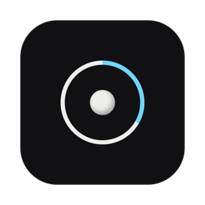
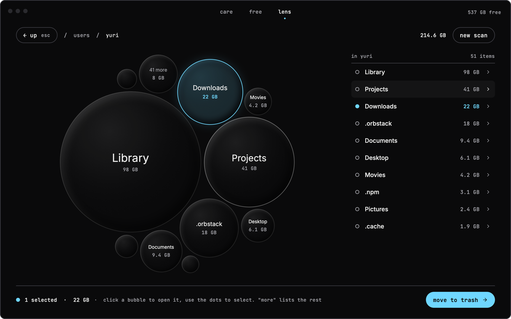
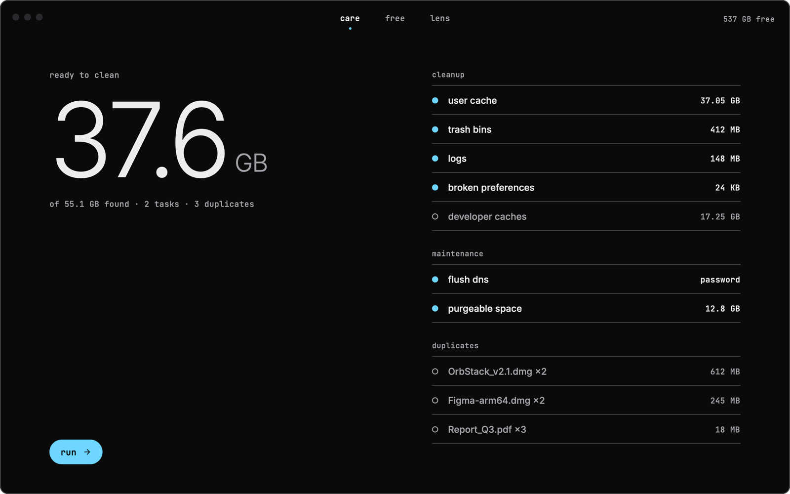
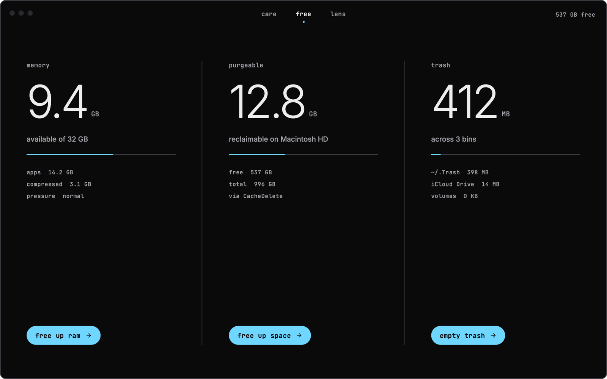

<div align="center">



# macoptimized

**A small, local-only Mac cleaner. Three tools, no accounts, no telemetry.**

[](#requirements)
[](Package.swift)
[](LICENSE)
[](https://github.com/2yuri/macoptimized/releases/latest)

[Download](#download) · [Features](#features) · [Build](#build-and-run) · [Safety](#safety) · [Contributing](#contributing)

</div>

---

|  |  |
|---|---|
| **care** | One scan for system junk, maintenance and duplicate downloads. You review everything before anything is removed. |
| **free** | Reclaim memory, purgeable disk space and the Trash, one action each. |
| **lens** | An interactive bubble map of what takes up space on a disk or folder. |

Everything runs on your Mac. Nothing is uploaded, and there is no background agent or privileged helper.

> [!WARNING]
> Early release. It is tested, but it deletes files. Read [Safety](#safety) before you press **run**.

## Preview

<p align="center">
  
</p>
<p align="center">
  
  
</p>

<p align="center"><sub>care · free · lens. Dark, hairlines and type, nothing else.</sub></p>

## Download

Grab the latest `MacOptimized-x.y.z.dmg` from [Releases](https://github.com/2yuri/macoptimized/releases/latest),
open it and drag **MacOptimized** to **Applications**. It runs on Apple silicon and Intel.

The build isn't notarized yet, so the first time, right-click the app and choose **Open**.

## Requirements

- macOS 14 Sonoma or later, Apple silicon or Intel
- Swift 6 toolchain (Xcode 16+ or the Command Line Tools)

## Build and run

```sh
git clone https://github.com/2yuri/macoptimized.git
cd macoptimized
./scripts/build-app.sh        # release build → build/MacOptimized.app (ad-hoc signed)
open build/MacOptimized.app
./scripts/make-dmg.sh         # → build/MacOptimized-<version>.dmg
```

`VERSION=1.2.3` sets the version (default: the latest git tag), `UNIVERSAL=1` builds for Apple silicon and Intel.

For development, `swift run` launches the app straight from the package.

### Full Disk Access

Without Full Disk Access, macOS hides the Trash, Mail data and parts of `~/Library`, so sizes come out smaller
than they are. Add `build/MacOptimized.app` in **System Settings › Privacy & Security › Full Disk Access**.
Ad-hoc signed builds may need to be re-added after each rebuild.

## Features

### care

Scans three modules one after another, then shows one review screen. Nothing changes until you press **run**.

| Module | What it finds | By default |
|---|---|---|
| Cleanup | User caches, user logs, Xcode DerivedData / ModuleCache / Simulator caches, broken `.plist` preferences, every Trash | selected |
| Cleanup | Developer caches (npm, Gradle, Bun, pnpm, CocoaPods), Xcode Device Support, iOS backups | listed only |
| Maintenance | Flush the DNS cache (asks for your password), free purgeable space | selected |
| Duplicates | Identical files in `~/Downloads` (same size, then SHA-256); the oldest copy is kept | listed only |

Caches of apps that are running, and caches that are really downloaded tools (such as `ms-playwright`), start
unselected. Apple caches that hold account state (CloudKit, iCloud, Family Sharing) are never touched.

### free

- **Memory**: used, available, compressed, swap and memory pressure, from `host_statistics64` with the formula
  Activity Monitor uses. *Free up* briefly allocates incompressible memory in the app's own process, so macOS
  evicts file cache and compresses idle pages, then releases it all. It stops after 30 s, at the first
  memory-pressure warning, or when you cancel.
- **Purgeable space**: measured as `volumeAvailableCapacityForImportantUsage − volumeAvailableCapacity`.
  *Free up* asks macOS's CacheDelete service to purge it (local snapshots, caches, evictable iCloud files).
- **Trash**: `~/.Trash`, `/Volumes/*/.Trashes/<uid>` and the iCloud Drive trash folders, emptied together.

### lens

Pick Macintosh HD, your home folder, an external volume or any folder. The scanner walks it concurrently,
counts on-disk (allocated) size, never follows symlinks, stays on the chosen volume, and skips virtual or
duplicate locations such as `/System/Volumes/Data` and `/private/var/vm`.

Results show one level at a time as packed bubbles, with area proportional to size; the smallest items are
grouped as *Other items*. Double-click a bubble to go in, double-click the background to go up, or jump with the
breadcrumb. Right-click for Finder and Quick Look. **move to trash** keeps everything restorable.

### Keyboard

| Key | Action |
|---|---|
| `⌘1` `⌘2` `⌘3` | care, free, lens |
| `return` | scan, run, confirm |
| `esc` | stop, cancel, go up a level in lens |
| `⌘O` | lens: choose a folder |

## Safety

- **care deletes permanently**: caches, logs and Trash contents are removed, not moved to the Trash.
  Everything is listed for review first, and removal is limited to paths inside your home folder or a volume
  Trash (`CareModel.isSafe`). Paths reached through a symlinked parent are refused.
- **lens and duplicates only move to the Trash.**
- **No privileged helper.** The only root operation is flushing DNS, through the standard macOS password prompt.
- **One private API.** Freeing purgeable space calls `CSDiskSpaceStartRecovery` from CoreServices via `dlsym`.
  It can change in a future macOS; the button is disabled when the symbol is missing.

## Project layout

```
Sources/MacOptimized/
├── App.swift        window, top bar, tabs
├── Design/          theme tokens, fonts, shared components (ring, bubble, modal, toast)
├── Core/            byte formatting, volumes, directory sizing, process helpers
├── Care/            junk rules, scanner, review UI
├── Free/            memory stats, RAM cleaner, purgeable space, trash bins
├── Lens/            disk scanner, file tree, circle packing, bubble map
└── Onboarding/      Full Disk Access screen
Tests/MacOptimizedTests/   Swift Testing suite
Resources/AppIcon.png      1024 px app icon (turned into .icns by the build script)
Resources/Fonts/           Inter and JetBrains Mono (SIL Open Font License)
scripts/build-app.sh       builds and ad-hoc signs build/MacOptimized.app
scripts/make-dmg.sh        packs it into build/MacOptimized-<version>.dmg
.github/workflows/         release pipeline
```

## Tests

```sh
swift test
```

With only the Command Line Tools installed (no Xcode), point the build at the bundled Swift Testing framework:

```sh
FW=/Library/Developer/CommandLineTools/Library/Developer/Frameworks
L=/Library/Developer/CommandLineTools/Library/Developer/usr/lib
swift test -Xswiftc -F$FW -Xlinker -F$FW -Xlinker -rpath -Xlinker $FW -Xlinker -rpath -Xlinker $L
```

The suite never deletes anything outside its own temporary folder. It covers circle packing, the disk scanner,
the safety guard, memory and volume metrics, and the default selection of the junk scan.

## Roadmap

- [ ] Live updates in lens via FSEvents
- [ ] Age thresholds per cleanup category
- [ ] Notarized release builds

## Releasing

[`.github/workflows/release.yml`](.github/workflows/release.yml) tests, builds a universal DMG and publishes a
GitHub release with its SHA-256.

- **From the terminal:** `git tag v0.1.0 && git push origin v0.1.0`
- **From GitHub:** Actions › release › Run workflow, type the version; the tag is created for you.
  Tick *dry run* to only build and test, with the DMG kept as a workflow artifact.

## Contributing

Issues and pull requests are welcome. Two ground rules:

1. Keep it local: no network calls, no analytics.
2. Every new cleanup rule comes with a test, including a case where it must **not** select something.

## Disclaimer

macoptimized is an independent project. It is not affiliated with or endorsed by any commercial Mac utility,
and contains no code or assets from one. Product names belong to their owners.

## License

[MIT](LICENSE). The bundled fonts, [Inter](https://rsms.me/inter/) and [JetBrains Mono](https://www.jetbrains.com/lp/mono/),
are under the SIL Open Font License; their licenses are in `Resources/Fonts`.
